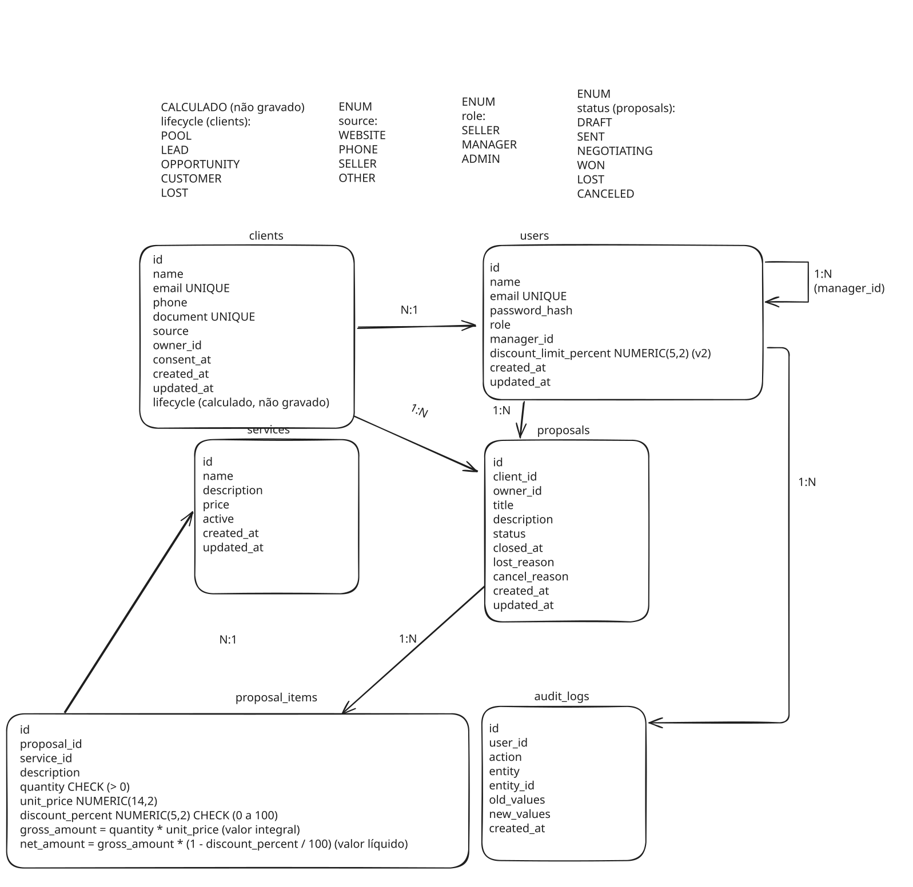
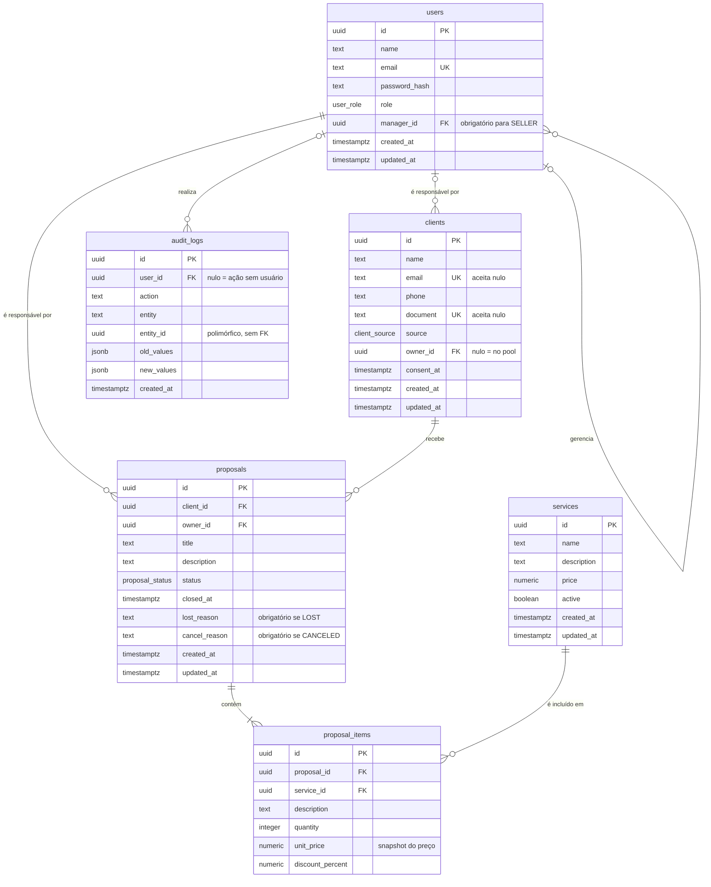

# Modelo de Domínio

> Como o negócio descrito no [levantamento de requisitos](requirements.md) é representado em dados, e por quê.
> Este documento descreve o modelo do **MVP**. As mudanças previstas para versões futuras estão na seção 7.

## Sumário

1. [Visão geral](#1-visão-geral)
2. [Diagrama ER](#2-diagrama-er)
3. [Entidades](#3-entidades)
4. [Relacionamentos](#4-relacionamentos)
5. [Enums](#5-enums)
6. [Decisões de modelagem](#6-decisões-de-modelagem)
7. [Evolução prevista](#7-evolução-prevista)

---

## 1. Visão geral

O modelo tem seis entidades, organizadas em torno do ciclo comercial:

1. Um visitante envia o formulário do site, e um **cliente** (`clients`) é criado sem responsável, no pool.
2. Um vendedor (`users`) reivindica o cliente, ou um gerente o atribui a alguém da equipe.
3. O vendedor cria **propostas** (`proposals`) para o cliente, compostas por **itens** (`proposal_items`) que referenciam o **catálogo de serviços** (`services`).
4. Uma proposta ganha passa a contar como venda.
5. As ações relevantes ao longo desse caminho ficam registradas no **log de auditoria** (`audit_logs`).

### Convenções

| Item | Convenção |
|---|---|
| Nomes de tabelas e colunas | Inglês, `snake_case`, tabelas no plural |
| Identificadores | `uuid`, para não expor o volume de registros nem permitir adivinhar IDs |
| Textos | `text`. Limites de tamanho ficam na validação da aplicação |
| Valores monetários | `numeric(14,2)`. Nunca ponto flutuante |
| Datas e horas | `timestamptz` (com fuso horário) |
| Chaves estrangeiras | `<entidade_no_singular>_id` |

---

## 2. Diagrama ER

Versão textual do diagrama, renderizada automaticamente pelo GitHub. Mostra a cardinalidade com mais precisão que o diagrama visual: distingue "zero ou muitos" de "um ou muitos".

---

## 3. Entidades

### services

Serviços de consórcio de Imóvel e consórcio de veículo

| Campo | Tipo | Nulo? | Regras | Origem |
|-------|------|:-:|--------|--------|
|`id`|uuid|não|PK|-|
|`name`|text|não|-|RF-014  |
|`description`|text|sim|Texto livre exibido no catálogo|RF-002|
|`price`   |numeric(14,2)|não|`CHECK (price >= 0)`, Preço vigente: alterá-lo não afeta as propostas existentes|RF-014,RN-004|
|`active`|boolean  |não    |Padrão `true`, inativo não aparece no catálogo público|RN-005|
|`created_at`   |timestamptz  |não|Padrão `now()`|-|
|`updated_at`   |timestamptz  |não|Atualizado a cada alteração|-|

**Observações**

- **Serviços não são excluídos, apenas desativados.** Um serviço já usado em propostas é referenciado por `proposal_items.service_id`, Excluí-lo quebraria essa referência e o histórico de vendas.
Por isso, "Remover do catálogo" significa `active=false` (RN-005).
- **`price` é o preço atual, não o preço de venda.** O preço praticado em cada proposta fica em `proposal_items.unit_price` (snapshot, RN-004).

### users

Pessoas da equipe comercial que acessam a área logada: vendedores, gerentes e administradores.

| Campo | Tipo | Nulo? | Regras | Origem |
|-------|------|:-:|--------|--------|
|`id`|uuid|não|PK|-|
|`name`|text|não|-|RF-015|
|`email`|text|não|o email é UNIQUE, para que não possa haver cadastro de dois usuários com o mesmo e-mail, evitando duplicação|RF-004|
|`password_hash`|text|não|nunca é retornado nenhuma resposta da API|RNF-002, RF-005, RF-004|
|`role`|`user_role` (`SELLER`, `MANAGER`, `ADMIN`)|não|Padrão `SELLER`|RF-015, RN-002|
|`manager_id`|uuid|sim|FK → `users.id`. Obrigatório quando `role = SELLER`: `CHECK (role <> 'SELLER' OR manager_id IS NOT NULL)`|RN-011|
|`created_at`|timestamptz  |não|Padrão `now()`|-|
|`updated_at`|timestamptz  |não|atualizado a cada alteração|-|

**Observações**

- **A senha nunca é armazenada, apenas o seu hash.** O hash é de mão única: não existe forma de revertê-lo para obter a senha. No login, o sistema aplica o hash à senha informada e compara com o valor armazenado. Assim, mesmo que o banco seja vazado, as senhas não ficam expostas (RNF-002).
- **A hierarquia é modelada por autorrelacionamento.** O vendedor aponta para o seu gerente na própria tabela `users`, por meio do `manager_id`, sem uma tabela `teams`. Uma tabela de equipes só se justificaria se elas tivessem dados próprios (nome, meta) ou se um vendedor pudesse pertencer a mais de uma equipe (RN-011).
- **O banco não garante que `manager_id` aponta para um gerente.** O `CHECK` só enxerga a própria linha: ele garante que todo vendedor *tem* um gerente, mas não que esse usuário tem `role = MANAGER`. Essa validação fica na camada de serviço.
- **O papel padrão é `SELLER` por ser o de menor privilégio.** Se o papel não for informado no cadastro, o usuário recebe o mínimo de acesso, e não o máximo, seguindo o princípio do menor privilégio.

### clients

Pessoas que submeteram o formulário no site ou entraram em contato direto com algum funcionário da empresa

| Campo | Tipo | Nulo? | Regras | Origem |
|-------|------|:-:|--------|--------|
|`id`|uuid|não|PK|-|
|`name`|text|não|—|RF-003, RF-006|
|`email`|text|sim|`UNIQUE`|RF-003, RN-013|
|`phone`|text|não|—|RF-003, CA-001|
|`document`|text|sim|`UNIQUE`|RN-013|
|`source`|`client_source` (`WEBSITE`, `PHONE`, `SELLER`, `OTHER`)|não|—|Decisão de modelagem: medir a conversão por canal|
|`owner_id`|uuid|sim|FK → `users.id`. Nulo = lead no pool|RN-001, RN-006, RF-019|
|`consent_at`|timestamptz|não|Preenchido apenas com o consentimento explícito do cliente. Sem valor padrão|RNF-004, CA-001, CA-002|
|`created_at`|timestamptz|não|Padrão `now()`|—|
|`updated_at`|timestamptz|não|-|-|

**Observações**

- **O e-mail é único para evitar clientes duplicados.** Ao detectar um duplicado, o sistema informa
  quem é o responsável atual (RN-013). Por ser `UNIQUE`, a coluna aceita vários nulos.
- **O documento é dado pessoal.** Por isso, o vendedor só vê os dados completos dos próprios
  clientes (RN-010).
- **`owner_id` nulo significa que o cliente está no pool.** Ele fica disponível para reivindicação
  por qualquer vendedor (RN-006).
- **A reivindicação é atômica.** Dois vendedores podem clicar em "pegar" ao mesmo tempo. Por isso,
  ela é feita com `UPDATE ... WHERE owner_id IS NULL`: só um consegue, e o outro recebe
  `409 Conflict` (RNF-005, CA-009).
- **O consentimento é registrado como data, e não como sim/não.** A LGPD exige que a empresa
  comprove o consentimento, e a data registra quando ele foi dado (RNF-004).
- **A fase do cliente (`lifecycle`) é calculada, não armazenada.** Os valores `POOL`, `LEAD`,
  `OPPORTUNITY`, `CUSTOMER` e `LOST` são deduzidos a partir do `owner_id` e do status das propostas.
  Ela não é gravada para não virar uma segunda fonte da verdade, que ficaria desatualizada quando
  uma proposta mudasse de status.

### proposals

Oferta de um ou mais serviços a um cliente. Ao ser ganha (`WON`), passa a contar como **venda**:
não existe uma entidade de venda separada.

| Campo | Tipo | Nulo? | Regras | Origem |
|---|---|:-:|---|---|
|`id`|uuid|não|PK|—|
|`client_id`|uuid|não|FK → `clients.id`|RF-008, CA-011|
|`owner_id`|uuid|não|FK → `users.id`. Vendedor responsável pela proposta|RN-001, RN-019, CA-011, CA-012|
|`title`|text|não|—|RF-008|
|`description`|text|não|—|RF-008|
|`status`|`proposal_status` (`DRAFT`, `SENT`, `NEGOTIATING`, `WON`, `LOST`, `CANCELED`)|não|Padrão `DRAFT`|RN-012, CA-011|
|`closed_at`|timestamptz|sim|Preenchido ao passar para `WON` ou `LOST`; nulo enquanto a proposta está em aberto: `CHECK ((status IN ('WON', 'LOST', 'CANCELED')) = (closed_at IS NOT NULL))`|RN-014, CA-016, CA-017|
|`lost_reason`|text|sim|Obrigatório quando perdida: `CHECK (status <> 'LOST' OR lost_reason IS NOT NULL)`|RN-015, CA-017, CA-018|
|`cancel_reason`|text|sim|Obrigatório quando cancelada: `CHECK (status <> 'CANCELED' OR cancel_reason IS NOT NULL)`|RN-003, RF-010, CA-021|
|`created_at`|timestamptz|não|Padrão `now()`|—|
|`updated_at`|timestamptz|não|Atualizado a cada alteração|—|

**Observações**

- **As transições de status são validadas na camada de serviço.** Um `CHECK` só enxerga o estado
  novo da linha, e validar uma transição exige comparar o status anterior com o novo. O service
  mantém um mapa das transições permitidas, equivalente à tabela da RN-012, e rejeita as demais
  com `422 Unprocessable Entity` (CA-019).
- **O motivo da perda é obrigatório por ser informação de gestão.** Ele serve de feedback para
  gerentes e administradores entenderem por que as vendas são perdidas, e de histórico para o
  próprio vendedor (RN-015).
- **A proposta tem um `owner_id` próprio, que não é cópia de `clients.owner_id`.** Ao reatribuir um
  cliente, apenas as propostas em aberto (`DRAFT`, `SENT`, `NEGOTIATING`) passam para o novo
  responsável. As fechadas (`WON`, `LOST`, `CANCELED`) permanecem com o vendedor original, para
  preservar o histórico e as métricas de vendas (RN-019). Por isso, os dois campos podem divergir.
- **`closed_at` continua preenchido após um cancelamento.** Uma proposta só chega a `CANCELED`
  vinda de `WON`, então a data de fechamento original é mantida.
- **O valor total da proposta é calculado, não armazenado.** Ele é a soma dos `net_amount` dos seus
  itens (RN-017). Gravá-lo criaria uma segunda fonte da verdade, que ficaria desatualizada a cada
  alteração nos itens.

### proposal_items

Cada serviço incluído em uma proposta, com a quantidade, o preço e o desconto praticados.
É a tabela associativa que resolve o relacionamento N:N entre `proposals` e `services`.

| Campo | Tipo | Nulo? | Regras | Origem |
|---|---|:-:|---|---|
|`id`|uuid|não|PK|—|
|`proposal_id`|uuid|não|FK → `proposals.id`. `ON DELETE CASCADE`|RF-008, RN-016|
|`service_id`|uuid|não|FK → `services.id`. `ON DELETE RESTRICT`. O serviço precisa estar ativo ao ser incluído|RF-008, RN-005, CA-014|
|`description`|text|não|Descrição do item exibida na proposta|RF-008|
|`quantity`|integer|não|`CHECK (quantity > 0)`|RF-008|
|`unit_price`|numeric(14,2)|não|`CHECK (unit_price >= 0)`. Copiado de `services.price` no momento da inclusão|RN-004, CA-011|
|`discount_percent`|numeric(5,2)|não|Padrão `0`. `CHECK (discount_percent BETWEEN 0 AND 100)`|RN-017|

**Observações**

- **A tabela existe para resolver um relacionamento N:N.** Uma proposta tem vários serviços, e um
  serviço aparece em várias propostas. Um `service_id` dentro de `proposals` permitiria apenas um
  serviço por proposta. Como a tabela existe, ela também guarda os atributos que pertencem à
  combinação proposta + serviço: quantidade, preço e desconto.
- **`unit_price` é um snapshot do preço.** Ele é copiado de `services.price` quando o item é
  incluído, e não acompanha alterações posteriores no catálogo. Assim, propostas antigas mantêm os
  termos em que foram negociadas (RN-004).
- **Os valores bruto e líquido são calculados, não armazenados.**
  - `gross_amount` (valor integral) = `quantity × unit_price`
  - `net_amount` (valor líquido) = `gross_amount × (1 − discount_percent / 100)`, arredondado para
    2 casas decimais, meio para cima (RN-017)

  A alternativa é usar colunas geradas do PostgreSQL (`GENERATED ALWAYS AS ... STORED`), que o banco
  calcula e mantém consistentes. A escolha depende do suporte do ORM e será feita no ADR do ORM.
- **As exclusões em cascata seguem as regras de negócio.** Ao excluir uma proposta (possível apenas
  em `DRAFT`, RN-016), seus itens são excluídos junto (`CASCADE`). Já um serviço referenciado não
  pode ser excluído (`RESTRICT`): ele é apenas desativado (RN-005).
- **Valores monetários nunca usam ponto flutuante.** No banco, `numeric`; na aplicação, o tipo
  `Decimal` ou valores inteiros em centavos, para evitar erros de arredondamento.

### audit_logs

Registro de quem fez qual alteração relevante no sistema, e quando. Não confundir com *atividade*
(interação com o cliente, como ligação ou reunião), que não faz parte do MVP.

| Campo | Tipo | Nulo? | Regras | Origem |
|---|---|:-:|---|---|
|`id`|uuid|não|PK|—|
|`user_id`|uuid|sim|FK → `users.id`. Nulo quando a ação não foi feita por um usuário autenticado|RF-016|
|`action`|text|não|Código da ação, por exemplo `LEAD_CLAIMED` ou `PROPOSAL_STATUS_CHANGED`|RF-016|
|`entity`|text|não|Nome da entidade afetada, por exemplo `clients` ou `proposals`|RF-016|
|`entity_id`|uuid|não|Identificador do registro afetado. Índice em (`entity`, `entity_id`)|RF-016, RF-017|
|`old_values`|jsonb|sim|Estado anterior dos campos alterados. Nulo em criações|RF-016|
|`new_values`|jsonb|sim|Estado novo dos campos alterados. Nulo em exclusões|RF-016|
|`created_at`|timestamptz|não|Padrão `now()`|—|

**Observações**

- **O log é imutável (*append-only*).** Registros nunca são alterados nem excluídos. Por isso, não
  há `updated_at`. Um log que pode ser editado não serve como prova do que aconteceu.
- **`user_id` aceita nulo para ações sem usuário autenticado.** O principal exemplo é a criação de
  um lead pelo formulário público do site (RF-003), feita por um visitante anônimo.
- **`entity_id` é uma associação polimórfica.** Ele aponta para tabelas diferentes conforme o valor
  de `entity`, por isso não pode ser uma FK, e o banco não garante que o registro referenciado
  existe. Para um log de auditoria, isso é aceitável: o log deve continuar existindo mesmo que o
  registro original seja excluído.
- **`old_values` e `new_values` guardam apenas os campos alterados.** Assim, é possível mostrar
  exatamente o que mudou, por exemplo `{"status": "NEGOTIATING"}` → `{"status": "WON"}`.
- **O log pode conter dados pessoais.** Como `old_values` e `new_values` podem incluir nome, e-mail
  ou documento, o acesso ao log segue as mesmas restrições de visibilidade (RN-010) e precisará de
  uma política de retenção (LGPD).

---

## 4. Relacionamentos

| Relacionamento | Cardinalidade | Chave estrangeira | Observação |
|---|---|---|---|
| Gerente → vendedores | 1 : N | `users.manager_id` | Autorrelacionamento. Obrigatório para `SELLER` (RN-011) |
| Usuário → clientes | 1 : N | `clients.owner_id` | O cliente pode não ter responsável: está no pool (RN-006) |
| Usuário → propostas | 1 : N | `proposals.owner_id` | Toda proposta tem um responsável (RN-019) |
| Cliente → propostas | 1 : N | `proposals.client_id` | Toda proposta pertence a um cliente (RF-008) |
| Proposta → itens | 1 : N | `proposal_items.proposal_id` | Toda proposta tem ao menos um item (CA-013). Exclusão em cascata |
| Serviço → itens | 1 : N | `proposal_items.service_id` | Serviço referenciado não pode ser excluído (RN-005) |
| Proposta ↔ serviço | N : N | via `proposal_items` | Resolvido pela tabela associativa |
| Usuário → logs | 1 : N | `audit_logs.user_id` | Ações sem usuário autenticado têm `user_id` nulo |

> A regra "toda proposta tem ao menos um item" não pode ser garantida por uma restrição simples do banco, porque envolve linhas de outra tabela. Ela é validada na camada de serviço (CA-013).

---

## 5. Enums

Os nomes no código seguem o idioma das tabelas (inglês). A documentação de negócio usa os termos em português.

### `user_role`

| Código | Negócio | Descrição |
|---|---|---|
| `SELLER` | Vendedor | Atende leads e gerencia os próprios clientes e propostas |
| `MANAGER` | Gerente | Gerencia a própria equipe, o catálogo e o pool de leads |
| `ADMIN` | Administrador | Acesso total, incluindo a gestão de gerentes |

### `client_source`

| Código | Negócio | Descrição |
|---|---|---|
| `WEBSITE` | Site | Formulário de interesse do site público |
| `PHONE` | Telefone | Contato telefônico com a empresa |
| `SELLER` | Vendedor | Cadastrado diretamente por um vendedor |
| `OTHER` | Outro | Qualquer outra origem |

### `proposal_status`

| Código | Negócio (RN-012) | Descrição |
|---|---|---|
| `DRAFT` | RASCUNHO | Em elaboração; o cliente ainda não viu |
| `SENT` | ENVIADA | Apresentada ao cliente, aguardando resposta |
| `NEGOTIATING` | EM_NEGOCIACAO | Cliente discutindo valores ou condições |
| `WON` | GANHA | Aceita pelo cliente: conta como venda |
| `LOST` | PERDIDA | Recusada pelo cliente; exige motivo |
| `CANCELED` | CANCELADA | Venda cancelada após ganha; exige motivo |

### `lifecycle` (calculado, não armazenado)

| Código | Quando |
|---|---|
| `POOL` | O cliente não tem responsável (`owner_id` nulo) |
| `LEAD` | Tem responsável, mas nenhuma proposta |
| `OPPORTUNITY` | Tem ao menos uma proposta em aberto (`DRAFT`, `SENT` ou `NEGOTIATING`) e nenhuma ganha |
| `CUSTOMER` | Tem ao menos uma proposta `WON` |
| `LOST` | Tem propostas, mas todas perdidas ou canceladas |

As regras são avaliadas de cima para baixo: um cliente com uma proposta ganha e outra em negociação é `CUSTOMER`.

---

## 6. Decisões de modelagem

Resumo das decisões não óbvias. O detalhamento está nas observações de cada entidade.

| # | Decisão | Motivo | Onde |
|---|---|---|---|
| 1 | Lead e cliente são a mesma tabela | São a mesma entidade em momentos diferentes. Duas tabelas exigiriam copiar dados na conversão | `clients` |
| 2 | Estados derivados não são gravados | `lifecycle` e valores totais são calculados, para não criar uma segunda fonte da verdade | `clients`, `proposals`, `proposal_items` |
| 3 | Tabela associativa entre propostas e serviços | Resolve o N:N e guarda os atributos da relação (quantidade, preço, desconto) | `proposal_items` |
| 4 | Snapshot do preço | Propostas antigas mantêm os termos negociados, mesmo se o catálogo mudar (RN-004) | `proposal_items` |
| 5 | Hierarquia por autorrelacionamento | Sem tabela `teams`, que só se justificaria com dados próprios das equipes (YAGNI) | `users` |
| 6 | `owner_id` próprio na proposta | Após uma reatribuição, propostas fechadas ficam com o vendedor original (RN-019) | `proposals` |
| 7 | Transições de status validadas na aplicação | Um `CHECK` só enxerga o estado novo da linha, não a transição | `proposals` |
| 8 | Consentimento registrado como data | A LGPD exige comprovar quando o consentimento foi dado | `clients` |
| 9 | Serviços são desativados, não excluídos | Preserva as referências e o histórico de vendas (RN-005) | `services` |
| 10 | Log imutável com associação polimórfica | O log precisa servir de prova e sobreviver à exclusão do registro original | `audit_logs` |

---

## 7. Evolução prevista

Mudanças já identificadas para depois do MVP. Cada uma deve ser revisada, e registrada em ADR quando relevante, ao entrar em desenvolvimento.

| Funcionalidade | Impacto no modelo | Origem |
|---|---|---|
| Alçada de desconto | Novo status `PENDING_APPROVAL` em `proposal_status` | RN-018, RF-024 |
| Configurações da equipe | Limite de desconto, limite de leads e tempo de retorno ao pool por gerente. Avaliar uma tabela `team_settings` (1:1 com o gerente) em vez de colunas em `users`, que ficariam nulas para vendedores e admins | RF-023 |
| Retorno do lead ao pool | Processo agendado que libera clientes não trabalhados em 24 horas. Não muda o modelo, mas exige infraestrutura de jobs | RN-009 |
| Aceite online pelo cliente | Tabela de tokens de acesso à proposta, com validade e uso único | RF-021 |
| Notificações | Tabela de notificações por usuário | RF-022 |
| Atividades com o cliente | Entidade para ligações, reuniões e mensagens, distinta do log de auditoria | Ideia futura |
| Multi-tenant | `tenant_id` em todas as tabelas e revisão das consultas | ADR-0001 |
| Colunas calculadas | `gross_amount` e `net_amount` como colunas geradas, se o ORM suportar | ADR do ORM (pendente) |